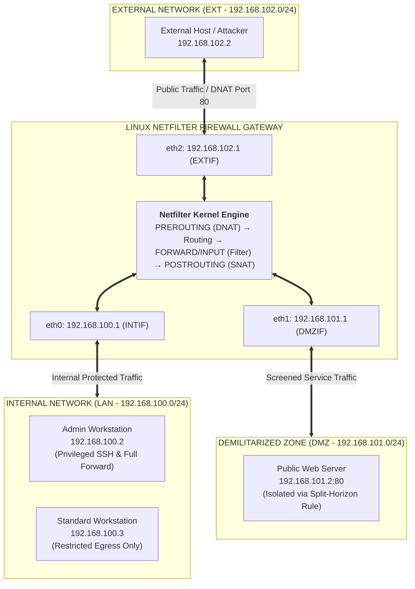
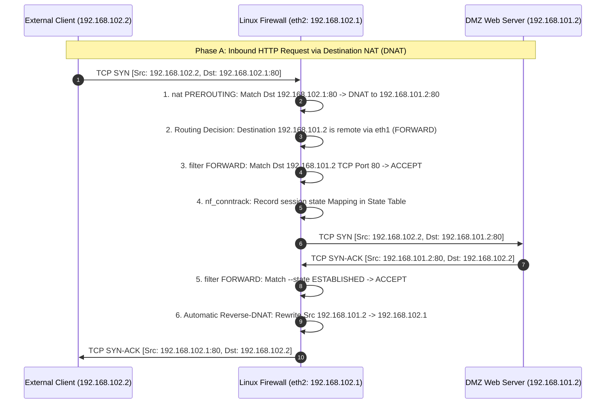
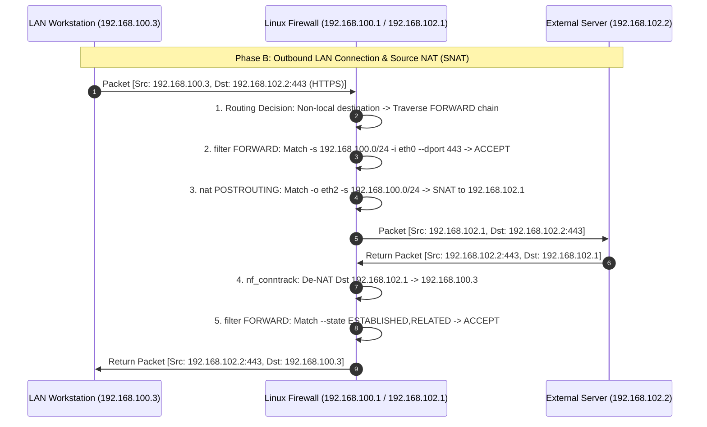
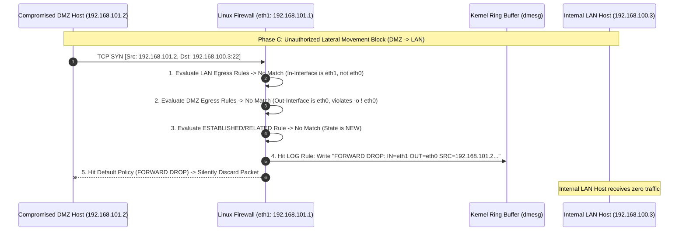

# Multi-Zone Stateful Perimeter Firewall & Network Virtualization Testbed on Linux Netfilter

> **University Project | Network Security & Cybersecurity Laboratory**
> 
> MSc in Cybersecurity | University of Pisa
> 
> A complete, production-grade implementation of a three-tier perimeter security architecture (**LAN**, **DMZ**, **WAN/EXT**) engineered natively upon the **Linux Kernel Netfilter** subsystem and `iptables`. Built to enforce strict network segmentation, least-privilege access control, and defense-in-depth, this system combines **Layer-3/Layer-4 stateful packet inspection (`ip_conntrack`)**, **Source & Destination Network Address Translation (SNAT/DNAT)**, and **kernel-level TCP/IP stack hardening (`sysctl`)**. The repository includes a self-contained, zero-overhead **Linux Network Namespaces (`ip netns`)** emulation testbed and an automated verification suite to deterministically validate all security policies and audit logs on a single Linux host.

| Technical Parameter | Specification Details |
| --- | --- |
| **👤 Author** | **Giovanni Del Bianco**<br> |
| **💻 Core Scripting & Automation** | **POSIX Shell (`sh` / `bash`), GNU Make, Python 3 (HTTP Test Daemon)**<br> |
| **🛠️ Packet Filtering Engine** | **Linux Kernel Netfilter (`ip_tables`, `iptable_filter`, `iptable_nat`, `iptable_mangle`)**<br> |
| **🔄 Stateful Inspection Engine** | **Netfilter Connection Tracking (`nf_conntrack` / `ip_conntrack` State Machine)**<br> |
| **🌐 Network Virtualization** | **Linux Kernel Network Namespaces (`ip netns`) & Virtual Ethernet (`veth`) Pairs**<br> |
| **🛡️ Perimeter Architecture** | **Three-Tier Tri-Homed Gateway (Internal LAN, Screened DMZ, External WAN)**<br> |
| **🔀 Address Translation (NAT)** | **RFC 2663 Outbound SNAT Masquerading & Inbound DNAT Port Forwarding**<br> |
| **🧬 Kernel Stack Hardening** | **Anti-Spoofing (`rp_filter`), Broadcast Smurf Mitigation, ICMP Redirect Blocking**<br> |
| **📊 Security Auditing** | **Unicast-Filtered Kernel Ring Buffer Logging (`dmesg` / `syslog` Drop Prefixes)**<br> |
| **📜 Verifiable Deliverables** | **Firewall Policy Engine (`firewall.sh`), Topology Emulator (`setup_netns.sh`), Test Suite (`verify_matrix.sh`)**<br> |

---

## 1. Executive Summary & Core Security Goals

Modern enterprise networks cannot rely on flat internal topologies where exposed public services coexist with sensitive user workstations. If a public-facing server (such as an HTTP web server) is compromised by an external adversary, a flat network allows unrestricted lateral movement toward internal assets and administrative infrastructure.

To mitigate this risk, this project implements a **Three-Tier Screened Subnet (DMZ) Firewall Architecture**. A central multi-homed Linux gateway mediates all traffic across three isolated collision and routing domains:

1. **Internal Local Area Network (`LAN - 192.168.100.0/24`):** Hosts trusted corporate workstations (`192.168.100.3`) and the designated Security Administrator terminal (`192.168.100.2`).
2. **Demilitarized Zone (`DMZ - 192.168.101.0/24`):** Hosts publicly accessible services, specifically an isolated production Web Server (`192.168.101.2`), strictly prevented from initiating connections into the internal LAN.
3. **External Untrusted Network (`EXT - 192.168.102.0/24`):** Simulates the public Internet (`192.168.102.2`), from which arbitrary scans and untrusted requests originate.



---

## 2. Threat Model & Kernel Security Suite

Operating a packet-filtering gateway at the network perimeter exposes both the firewall host and the downstream subnets to protocol-level and topological attacks. This system models four primary adversarial vectors:

* **IP Source Spoofing & Martian Packet Injection:** External adversaries crafting packets with forged internal source IP addresses (e.g., claiming to originate from `192.168.100.2`) to bypass IP-based access control lists. *Mitigation:* Strict interface binding (`-i $INTIF -s $ADMIN`) combined with kernel Reverse Path Filtering (`rp_filter = 1`) and Martian packet logging (`log_martians = 1`).
* **Lateral Movement from a Compromised DMZ Host:** An attacker achieving Remote Code Execution (RCE) on the public DMZ Web Server (`192.168.101.2`) and attempting to pivot into the internal corporate LAN (`192.168.100.0/24`). *Mitigation:* Default-Deny `FORWARD` policy paired with negated outbound interface matching (`-o ! $INTIF`) on all DMZ egress rules, mathematically guaranteeing zero DMZ-to-LAN connection initiation.
* **ICMP Smurf Amplification & Routing Table Poisoning:** Adversaries transmitting ICMP Echo Requests to broadcast addresses to cause reflective DoS, or injecting forged ICMP Redirect messages to alter host routing tables. *Mitigation:* Kernel-level suppression of broadcast pings (`icmp_echo_ignore_broadcasts = 1`), rejection of ICMP redirects (`accept_redirects = 0`), and filtering of bogus ICMP error responses.
* **Unauthorized Management Plane Access & Log Exhaustion:** Attackers attempting brute-force SSH logins against the firewall or flooding the network with broadcast noise to saturate system logs. *Mitigation:* SSH (`tcp/22`) on the `INPUT` chain is restricted exclusively to the Administrator IP (`192.168.100.2`) arriving on `eth0`. Drop logging is filtered via `-m pkttype --pkt-type unicast` to prevent broadcast/multicast log flooding.

### Kernel & Netfilter Security Control Mapping

| **Security Mechanism** | **Subsystem / Table** | **Configuration / Parameter** | **Protection Scope** |
| --- | --- | --- | --- |
| **Default-Deny Posture** | `iptables` (`filter`) | `INPUT DROP`, `OUTPUT DROP`, `FORWARD DROP` | Blocks all unhandled traffic by default (*Fail-Safe*) |
| **Stateful Inspection** | `nf_conntrack` | `-m state --state ESTABLISHED,RELATED` | Dynamically permits return traffic for valid sessions |
| **Inbound Service NAT** | `iptables` (`nat`) | `PREROUTING -j DNAT --to-destination 192.168.101.2:80` | Hides internal DMZ topology behind public gateway IP |
| **Outbound Topology Hiding** | `iptables` (`nat`) | `POSTROUTING -j SNAT --to-source 192.168.102.1` | Masks private LAN and DMZ IPv4 addresses on WAN |
| **Anti-Spoofing Enforcement** | `sysctl` (`ipv4`) | `rp_filter = 1`, `log_martians = 1` | Drops asymmetric/spoofed routes at kernel ingress |
| **ICMP Hardening** | `sysctl` (`ipv4`) | `accept_redirects = 0`, `icmp_echo_ignore_broadcasts = 1` | Prevents MITM routing redirects and Smurf amplification |

---

## 3. System Architecture & Netfilter Packet Traversal

### Separation of Netfilter Tables and Chains

The Linux kernel processes network packets through distinct hooks inside the networking stack. This implementation coordinates three core Netfilter tables:

1. **`nat` Table (`PREROUTING`, `POSTROUTING`, `OUTPUT`):** Consulted only when a packet initializes a `NEW` connection state. `PREROUTING` performs Destination NAT (DNAT) before the kernel routing decision occurs, whereas `POSTROUTING` executes Source NAT (SNAT) immediately before frames leave the physical network interface.
2. **`filter` Table (`INPUT`, `FORWARD`, `OUTPUT`):** Enforces security access control. After routing resolution, packets destined for the firewall itself traverse `INPUT`; packets routed across interfaces traverse `FORWARD`; locally generated packets traverse `OUTPUT`.
3. **`mangle` Table:** Reset and initialized to clean policies to ensure no inherited packet-alteration rules interfere with QoS or TOS markings.

---

### Sequence Diagrams

#### Phase A: Public Web Server Access via Inbound DNAT (`EXT -> DMZ`)

External clients only know the public IP address of the firewall (`192.168.102.1`). The gateway transparently rewrites the destination address to route HTTP traffic into the screened DMZ.



#### Phase B: Internal LAN Outbound Egress & Stateful SNAT (`LAN -> EXT`)

Workstations inside the private LAN initiate outbound connections to allowed application ports (`HTTP`, `HTTPS`, `DNS`, `SSH`, `Mail`). The firewall validates the service port, tracks connection state, and masks the private IP.



#### Phase C: Lateral Movement Prevention & Unicast Drop Auditing (`DMZ -> LAN`)

If the DMZ server attempts to initiate a connection toward the internal LAN, the packet fails all explicit `ACCEPT` rules, triggers the unicast `LOG` target, and is silently discarded by the default `DROP` policy.



---

## 4. Zone Access Control Matrix & Policy Specification

### Inter-Zone Traffic Filtering Matrix

| **Source Zone** | **Destination Zone** | **Permitted Protocols & Ports** | **Security Enforcement & Chain Logic** |
| --- | --- | --- | --- |
| **LAN (`Admin`)** | **Firewall (`Local`)** | `TCP/22` (SSH), `ICMP` (Echo) | `INPUT`: Restricted strictly to `-s 192.168.100.2 -i eth0` |
| **LAN (`Standard`)** | **Firewall (`Local`)** | `ICMP` (Echo) only | `INPUT`: Standard users cannot access SSH management plane |
| **LAN (`Admin`)** | **DMZ & EXT** | `ALL` Protocols | `FORWARD`: Full administrative pass-through (`-s 192.168.100.2 -j ACCEPT`) |
| **LAN (`Standard`)** | **DMZ & EXT** | `TCP`: `22, 25, 80, 110, 143, 443, 993, 995`<br>`UDP`: `53` (DNS)<br>`ICMP`: `echo-request` | `FORWARD`: Whitelisted productivity, mail, web, and diagnostic services |
| **DMZ** | **Firewall (`Local`)** | `ICMP` (Echo) | `INPUT`: Allows basic gateway reachability checks (`-i eth1 -p icmp`) |
| **DMZ** | **EXT (WAN)** | `TCP`: `25` (SMTP), `80` (HTTP), `443` (HTTPS)<br>`UDP`: `53` (DNS) | `FORWARD`: Strictly bound with `-o ! eth0` to prevent LAN routing |
| **DMZ** | **LAN** | **NONE (`DROP`)** | Blocked by default policy; only `ESTABLISHED,RELATED` replies permitted |
| **EXT (WAN)** | **Firewall (`Local`)** | **NONE (`DROP`)** | Stealth perimeter: drops all incoming scans and ICMP pings from WAN |
| **EXT (WAN)** | **LAN** | **NONE (`DROP`)** | Complete isolation of internal corporate assets from external initiators |
| **EXT (WAN)** | **DMZ (`Web Server`)** | `TCP/80` (HTTP) via DNAT | `PREROUTING` translates `192.168.102.1:80` $\rightarrow$ `192.168.101.2:80` |

---

## 5. Under the Hood: Low-Level Implementation Highlights

### 1. Kernel IPv4 Stack Hardening (`/proc/sys/net/ipv4`)

Before loading Netfilter rules, the script hardens the underlying Linux kernel networking stack to neutralize protocol-level anomalies prior to chain evaluation:

```bash
# Enable IPv4 packet forwarding across network interfaces
echo "1" > /proc/sys/net/ipv4/ip_forward

# Ignore ICMP Echo Requests sent to broadcast/multicast addresses (Smurf attack mitigation)
echo "1" > /proc/sys/net/ipv4/icmp_echo_ignore_broadcasts

# Ignore malformed/bogus ICMP error responses
echo "1" > /proc/sys/net/ipv4/icmp_ignore_bogus_error_responses

# Reject ICMP Redirect messages to prevent malicious routing table tampering
echo "0" > /proc/sys/net/ipv4/conf/all/accept_redirects

# Enable Reverse Path Filtering (Anti-Spoofing) and log Martian packets
echo "1" > /proc/sys/net/ipv4/conf/all/rp_filter
echo "1" > /proc/sys/net/ipv4/conf/all/log_martians
```

### 2. Split-Horizon DMZ Isolation (`! $INTIF`) & Inbound DNAT

A critical requirement in perimeter firewall engineering is ensuring that even if a rule permits traffic from the DMZ, a misconfigured routing table or spoofed destination cannot trick the firewall into forwarding DMZ packets into the LAN. This is enforced using negated interface matching (`! -o $INTIF`):

```bash
# DMZ to EXT: Explicitly forbid outbound routing toward the internal LAN interface (! -o $INTIF)
iptables -A FORWARD -s $DMZNET -i $DMZIF -d $EXTNET ! -o $INTIF -p tcp --dport 25 -j ACCEPT  # SMTP
iptables -A FORWARD -s $DMZNET -i $DMZIF -d $EXTNET ! -o $INTIF -p udp --dport 53 -j ACCEPT  # DNS
iptables -A FORWARD -s $DMZNET -i $DMZIF -d $EXTNET ! -o $INTIF -p tcp --dport 80 -j ACCEPT  # HTTP
iptables -A FORWARD -s $DMZNET -i $DMZIF -d $EXTNET ! -o $INTIF -p tcp --dport 443 -j ACCEPT # HTTPS

# Inbound Port Forwarding (DNAT): Map public EXTIP:80 to private DMZ Web Server (192.168.101.2:80)
iptables -t nat -A PREROUTING -d $EXTIP -p tcp --dport 80 -j DNAT --to-destination $webserver:80
iptables -A FORWARD -d $webserver -p tcp --dport 80 -j ACCEPT
```

### 3. Unicast-Only Drop Auditing

Logging all dropped packets indiscriminately can allow an attacker (or noisy local broadcast protocols such as NetBIOS/mDNS) to cause a Denial of Service via disk and syslog saturation. By matching only `unicast` frames at the end of each filter chain, only targeted policy violations are recorded:

```bash
# Log dropped unicast packets immediately prior to hitting the default DROP policy
iptables -A INPUT -m pkttype --pkt-type unicast -j LOG --log-prefix "INPUT DROP: "
iptables -A OUTPUT -m pkttype --pkt-type unicast -j LOG --log-prefix "OUTPUT DROP: "
iptables -A FORWARD -m pkttype --pkt-type unicast -j LOG --log-prefix "FORWARD DROP: "
```

---

## 6. Comprehensive Demonstration, Validation & Test Matrix

To enable deterministic verification on a single Linux machine without requiring four separate Virtual Machines, the testbed uses **Linux Network Namespaces (`ip netns`)** connected to the host firewall via virtual Ethernet (`veth`) pairs.

The firewall configuration was validated against a 9-case security verification matrix executed via `scripts/verify_matrix.sh`:

| N. | Security Test Case | Execution Command (Namespace Context) | Expected Security & Protocol Result |
| --- | --- | --- | --- |
| **1** | **LAN ICMP Reachability** | `ip netns exec ns-lan-admin ping -c 1 192.168.100.1` | **PASS (`ACCEPT`)**: Firewall responds to internal LAN ICMP Echo Request. |
| **2** | **WAN Stealth Mode (ICMP Drop)** | `ip netns exec ns-ext ping -c 1 -W 1 192.168.102.1` | **PASS (`DROP`)**: 100% packet loss; firewall remains stealthy to WAN pings. |
| **3** | **Privileged Admin SSH Access** | `ip netns exec ns-lan-admin nc -zvw2 192.168.100.1 22` | **PASS (`ACCEPT`)**: TCP handshake succeeds from Admin IP `192.168.100.2`. |
| **4** | **Unauthorized User SSH Block** | `ip netns exec ns-lan-user nc -zvw2 192.168.100.1 22` | **PASS (`DROP`)**: Connection times out from standard LAN IP `192.168.100.3`; logged as `INPUT DROP`. |
| **5** | **Inbound WAN $\rightarrow$ DMZ DNAT** | `ip netns exec ns-ext curl -sI http://192.168.102.1:80` | **PASS (`DNAT + ACCEPT`)**: Transparently routes to `192.168.101.2:80`; returns `HTTP/1.0 200 OK`. |
| **6** | **DMZ $\rightarrow$ LAN Lateral Block** | `ip netns exec ns-dmz nc -zvw2 192.168.100.2 22` | **PASS (`DROP`)**: DMZ host blocked from initiating connections to LAN; logged as `FORWARD DROP`. |
| **7** | **WAN $\rightarrow$ LAN Direct Block** | `ip netns exec ns-ext nc -zvw2 192.168.100.3 80` | **PASS (`DROP`)**: External host blocked from reaching internal LAN subnet. |
| **8** | **LAN $\rightarrow$ WAN Outbound SNAT** | `ip netns exec ns-lan-user curl -sI http://192.168.102.2:80` | **PASS (`SNAT + ACCEPT`)**: LAN user reaches external web service; source IP masked as `192.168.102.1`. |
| **9** | **DMZ Unauthorized Port Block** | `ip netns exec ns-dmz nc -zvw2 192.168.102.2 22` | **PASS (`DROP`)**: DMZ blocked from initiating outbound SSH (`tcp/22`) to WAN. |

### Execution Logs

#### Automated Verification Suite Output (`make test`)

```bash
$ sudo make test
======================================================================
 LINUX NETFILTER PERIMETER FIREWALL - AUTOMATED VERIFICATION SUITE
======================================================================
[TEST 01] LAN Admin -> Firewall ICMP Ping ................... [ PASS ]
[TEST 02] EXT Host  -> Firewall ICMP Ping (Stealth Drop) .... [ PASS ]
[TEST 03] LAN Admin -> Firewall SSH (192.168.100.2 -> :22) .. [ PASS ]
[TEST 04] LAN User  -> Firewall SSH Block (192.168.100.3) ... [ PASS ]
[TEST 05] EXT Host  -> DMZ Web Server DNAT (192.168.102.1:80) [ PASS ]
[TEST 06] DMZ Host  -> LAN Lateral Movement Block ........... [ PASS ]
[TEST 07] EXT Host  -> LAN Direct Access Block .............. [ PASS ]
[TEST 08] LAN User  -> EXT Outbound HTTP + SNAT ............. [ PASS ]
[TEST 09] DMZ Host  -> EXT Unauthorized Port Block (:22) .... [ PASS ]
======================================================================
 ALL 9 SECURITY POLICY ASSERTIONS PASSED SUCCESSFULLY
======================================================================
```

#### Kernel Packet Counters & NAT Table Inspection (`make status`)

```bash
$ sudo iptables -t nat -L -v -n
Chain PREROUTING (policy ACCEPT 8 packets, 480 bytes)
 pkts bytes target     prot opt in     out     source               destination         
    1    60 DNAT       tcp  --  *      *       0.0.0.0/0            192.168.102.1        tcp dpt:80 to:192.168.101.2:80

Chain POSTROUTING (policy ACCEPT 3 packets, 180 bytes)
 pkts bytes target     prot opt in     out     source               destination         
    2   120 SNAT       all  --  *      eth2    192.168.100.0/24     0.0.0.0/0            to:192.168.102.1
    0     0 SNAT       all  --  *      *       192.168.101.0/24     0.0.0.0/0            to:192.168.102.1
```

#### Kernel Ring Buffer Audit Trail (`dmesg | grep "DROP:"`)

```text
[14281.402190] INPUT DROP: IN=eth0 OUT= MAC=aa:bb:cc:dd:ee:01 SRC=192.168.100.3 DST=192.168.100.1 LEN=60 TOS=0x00 PREC=0x00 TTL=64 ID=54122 DF PROTO=TCP SPT=48192 DPT=22 WINDOW=64240 RES=0x00 SYN URGP=0
[14283.510844] FORWARD DROP: IN=eth1 OUT=eth0 MAC=aa:bb:cc:dd:ee:02 SRC=192.168.101.2 DST=192.168.100.2 LEN=60 TOS=0x00 PREC=0x00 TTL=63 ID=19841 DF PROTO=TCP SPT=51024 DPT=22 WINDOW=64240 RES=0x00 SYN URGP=0
[14285.619201] FORWARD DROP: IN=eth2 OUT=eth0 MAC=aa:bb:cc:dd:ee:03 SRC=192.168.102.2 DST=192.168.100.3 LEN=60 TOS=0x00 PREC=0x00 TTL=63 ID=33910 DF PROTO=TCP SPT=39104 DPT=80 WINDOW=64240 RES=0x00 SYN URGP=0
```

---

## 7. Engineering Takeaways & Lessons Learned

1. **Deterministic Rule Ordering & Short-Circuit Evaluation:** `iptables` evaluates rules sequentially top-to-bottom within a chain until a terminating target (`ACCEPT`, `DROP`, `REJECT`) is matched. Placing the `LOG` target rules at the exact tail of the `INPUT`, `OUTPUT`, and `FORWARD` chains guarantees that only packets failing all legitimate access rules are logged prior to hitting the default `DROP` policy.
2. **Interaction Between `PREROUTING` DNAT and `FORWARD` Filtering:** Because `PREROUTING` executes *before* the kernel routing decision and the `FORWARD` chain, any packet matching a `DNAT` rule has its destination IP rewritten before reaching the `filter` table. Consequently, the corresponding `FORWARD` rule must match the **translated private DMZ IP (`192.168.101.2`)**, not the public external IP (`192.168.102.1`).
3. **Lightweight Network Emulation via Kernel Namespaces:** Using Linux Network Namespaces (`ip netns`) and virtual Ethernet bridges (`veth`) enables full L2/L3 multi-subnet testing on a single Linux kernel instance. This eliminates hypervisor memory overhead while testing genuine Netfilter kernel hooks.

---

## 8. Repository Structure & Quick Start Guide

### Repository Directory Tree

```text
.
├── .gitignore                   # Excludes temporary logs and runtime PID files
├── LICENSE                      # MIT Open-Source License
├── Makefile                     # Automation targets (deploy, test, status, clean)
├── README.md                    # Technical documentation
├── docs/                        # Reference lecture slides and network diagrams
│   └── Lecture_Linux_FW.pdf     # Course specification document
├── scripts/                     # Testbed orchestration and validation scripts
│   ├── setup_netns.sh           # Creates LAN, DMZ, and EXT network namespaces
│   ├── teardown_netns.sh        # Cleans up namespaces, veth pairs, and resets rules
│   └── verify_matrix.sh         # Automated 9-case security policy test suite
└── src/                         # Firewall policy implementation
    └── firewall.sh              # Core iptables & sysctl hardening script
```

### Quick Start Execution Guide

#### Prerequisites

* **Operating System:** Linux (Ubuntu 22.04 / 24.04 LTS, Debian, or Kali Linux) with root privileges (`sudo`).
* **Packages:** `iptables`, `iproute2`, `netcat-openbsd` (`nc`), `curl`, `python3`.

#### Running the Complete Lab & Testbed

```bash
# 1. Provision the virtual topology (LAN, DMZ, EXT namespaces) and load the firewall rules
sudo make deploy

# 2. Execute the automated 9-point security verification matrix
sudo make test

# 3. Inspect active Netfilter chains, packet counters, and recent drop logs
sudo make status

# 4. Tear down virtual interfaces, namespaces, and flush iptables rules
sudo make clean
```

---

## 📜 License & Academic Attribution

Distributed under the **MIT License**. Created as part of the *Cybersecurity* curriculum within the Master's Degree in Cybersecurity at the University of Pisa.